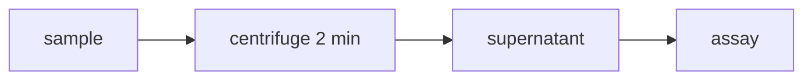

# Review files

## `final.md`

Base this file on the supplied template. Strict mode retains unsupported fields blank; guided mode omits unsupported optional subfields while preserving fixed headings and metadata. Insert uncertainty markers immediately after the ambiguous item, for example:

```markdown
- 渗透率：$0.1\sim10\times10^{-15}\,\mathrm{m^2}$ ⟦U001⟧
```

Do not add a generic disclaimer in every blank field. One short provenance note is acceptable only if the template has an appropriate place for it.

A structured sketch becomes a table or graph of its meaning (synthetic example). The sketch shows tubes T1 T2 | T3 T4, a bracket labelled "25 °C" under T1–T2 and "37 °C" under T3–T4, and arrows from T1 and T3 to "control, no stirring" and from T2 and T4 to "stirred 10 min":

```markdown
| Group | Treatment | 25 °C | 37 °C |
| --- | --- | --- | --- |
| control | no stirring | T1 | T3 |
| stirred | 10 min | T2 | T4 |
```

Columns come from the bracket labels and rows from the arrow targets; traceability records that mapping. A drawn sequence or flow becomes a Mermaid graph whose nodes and edges are exactly the drawn labels and arrows:



## `uncertainties.md`

Use this structure:

```markdown
# Manual review queue

| ID | Type | Source | Best literal reading | Alternatives | Why uncertain | Final location | Required check |
| --- | --- | --- | --- | --- | --- | --- | --- |
| U001 | reading | page 1, lower middle | `10^-15 m²` | `10^-13 m²` | exponent stroke is crowded | 2. 对象与实际条件 / material | compare against original at high zoom |
| U002 | reading | page 1, line 4 | `stir` + one extra glyph | possibly deleted; another character | a short stroke crosses the glyph | 3 / operations | deleted or content? |
| U003 | source-check | page 1, line 6 | `−0.8 MPa` (legible) | — | below full vacuum; possibly a slip | 3 / operations | confirm the value as written |
```

`Type` takes exactly one of:

- `reading`: what the characters, symbols or structure are, including "deleted or content?";
- `relationship`: what links, arrows, brackets, ownership or a legend mean;
- `source-check`: clearly read, but possibly wrong in the source (arithmetic, physics, inconsistency); never changed by the transcription;
- `deleted-only`: concerns only deleted material; its marker appears in `traceability.md`, never in `final.md`. Not used under an omit legend.

Use the same ID everywhere. Do not assign an uncertainty merely because a template field is blank.

IDs in the active queue must appear in either `final.md` or `traceability.md`. A doubt concerning only deleted or unmapped material belongs in the latter; do not insert it artificially into the final experiment record. Use stable IDs across revisions; remove resolved IDs from the active queue and retain their resolution history separately. Author-confirmed relationships do not automatically confirm every numeric character in the same region.

When no uncertainties remain, write:

```markdown
# Manual review queue

No unresolved transcription uncertainties were identified. Human review is still required for scientific records.
```

## `traceability.md`

Start with a source manifest:

```markdown
# Traceability

- Source: `<exact filename>`
- Pages inspected: `<range/list>`
- Template: `<exact filename>`
- OCR draft: `<filename or none>`
- Author profile: `<filename (SHA-256)>; legends applied: L1, L2` or `none`
```

Then include a page-level table:

```markdown
| Evidence ID | Source region | Status | Literal content or concise description | Final destination |
| --- | --- | --- | --- | --- |
| E001 | page 1, top right | confirmed | `2026.4.16` | experiment date |
| E002 | page 1, middle | crossed out | earlier Reynolds-number calculation | actual operations/observations |
| E003 | page 1, bottom | unmapped | question about flow velocity and Re | manual placement needed |
| E004 | page 1, line 5 | confirmed | `add [deletion] buffer` (omit legend L1: location only) | 3 / operations |
| E005 | page 2, sketch | confirmed | tubes T1–T4, two brackets, four arrows | 2 / table: brackets → columns, arrow targets → rows |
```

The literal-content column may use Markdown or LaTeX. Keep it faithful and concise; this is an audit map, not a rewritten narrative.

## Optional machine-readable page ledger

`evidence.json` can be supplied to `validate_outputs.py --evidence evidence.json`:

```json
{
  "source": "note.pdf",
  "page_count": 1,
  "inspected_pages": [1],
  "evidence": [
    {"id":"E001", "page":1, "region":"top right", "status":"confirmed", "text":"4.16", "destination":"date"}
  ]
}
```

Supported statuses: `confirmed`, `uncertain`, `crossed out`, `revised`, `unmapped`, `user-confirmed`, `blank`. Include an explicit blank-page item after inspecting an empty page. For multiple PDFs, use one ledger per source to prevent page-number collisions. Keep this ledger synchronized with the Markdown map. Preparation manifests record render completion, not inspection.

Optional role, parent, related-ID and required-final-anchor fields are documented in [guided-template.md](guided-template.md). Guidance-only prompts and illustrative tables are excluded from validation in guided mode; literal fixed structure outside those comments is still checked. Conversion date can be validated against `--run-date`. An optional `--template-mode strict|guided` override is available for explicitly authorized mode selection; unmarked templates default to strict.

The validator checks headings, colon-terminated bullet prompt labels and their section/order, table headers and row widths, template-derived angle-bracket placeholders, bidirectional uncertainty references, queue `Type` values and that `deleted-only` IDs stay out of `final.md`, required provenance fields and optional ledger page coverage. A queue without a `Type` column (from 1.2.0 or earlier) only produces a warning. With `--profile <file>` it also checks the author profile and the legends cited in the manifest ([author-profile.md](author-profile.md)). It does not prove handwriting accuracy, semantic mapping, actual visual inspection or exhaustive transcription. Other prompt styles still require manual structural review.

## Final response

Tell the user which files were produced, how many unresolved uncertainty items remain, and whether any legible evidence remains unmapped. Never state that the transcription is scientifically verified; the user has reserved final review and correction.
